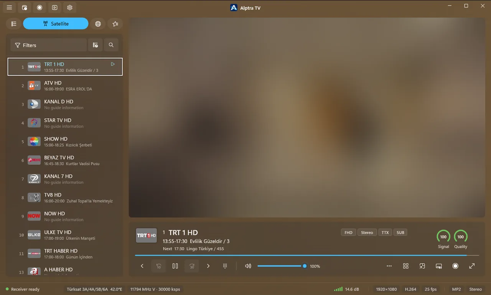
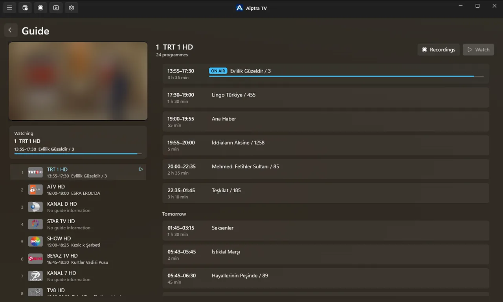
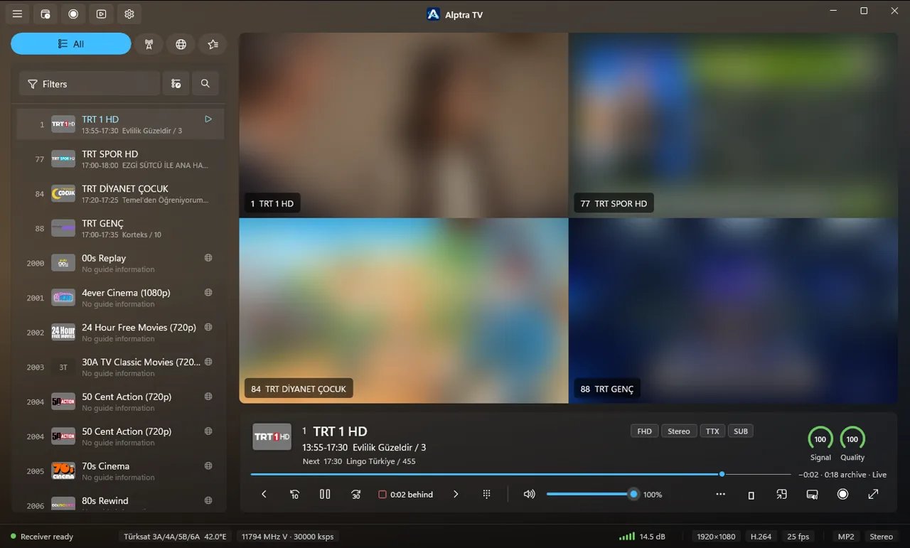

<p align="center">
  
</p>

<h1 align="center">Alptra TV for Windows</h1>

<p align="center">
  Satellite and IPTV player for Windows 10 and 11.<br>
  <a href="https://alptra.xacnio.dev">Website</a> ·
  <a href="https://github.com/xacnio/alptra-tv-windows/releases/latest">Latest release</a> ·
  <a href="https://apps.microsoft.com/detail/9NX6G6PXDHKC">Microsoft Store</a> ·
  <a href="README_tr.md">Türkçe</a>
</p>

<p align="center">
  
  
</p>

Free, no account needed. This repository hosts the Windows downloads; the app is also on the
Microsoft Store.

<p align="center">
  <a href="https://github.com/xacnio/alptra-tv-windows/releases/latest"></a>
  <a href="https://apps.microsoft.com/detail/9NX6G6PXDHKC"></a>
</p>

## Download

Get the files from the [latest release](https://github.com/xacnio/alptra-tv-windows/releases/latest):

| File | For |
|---|---|
| `AlptraTV_<version>_x64_setup.exe` | Most PCs (Intel, AMD). **Not sure? Take this one.** |
| `AlptraTV_<version>_arm64_setup.exe` | Windows on ARM (Snapdragon) |
| `AlptraTV_<version>_x64.zip` | Portable version, x64 |
| `AlptraTV_<version>_arm64.zip` | Portable version, ARM64 |

Requires Windows 10 (version 2004) or later. The installer doesn't need administrator rights.
For the portable version, unpack the zip anywhere and run `Alptra.Tv.App.exe`. Your settings and
channel lists are stored separately, so they stay when you update or uninstall.

### "Windows protected your PC"

The files aren't code-signed, so SmartScreen may block the first start. Click **More info**, then
**Run anyway**. Every release lists SHA-256 checksums and VirusTotal scans if you want to check a
file:

```powershell
Get-FileHash .\AlptraTV_<version>_x64_setup.exe
```

## Updates

The installed version checks for updates by itself (Settings → Updates) and installs them in one
click, or automatically if you turn that on. The portable version tells you when a new release is
out; unpack it over the old folder. The Store version is updated by the Store.

## Features

- Satellite TV from a USB receiver: DVB-S/S2, channel scan, blind scan
- SAT>IP receivers, and sharing your USB receiver with other devices at home
- M3U and Xtream Codes playlists, in one list with your satellite channels
- Programme guide (broadcast and XMLTV) and teletext
- Several channels at once
- Recording, scheduled recording, pausing and rewinding live TV
- Film and series library, radio, channel manager
- YouTube, Twitch and Kick channels

<p align="center">
  
</p>

## Contact

Found a bug or have an idea? [Open an issue](https://github.com/xacnio/alptra-tv-windows/issues/new/choose)
or write to [alptra@xacnio.dev](mailto:alptra@xacnio.dev).
Support the project: [Buy Me a Coffee](https://buymeacoffee.com/xacnio)

© 2026 Alperen Çetin
