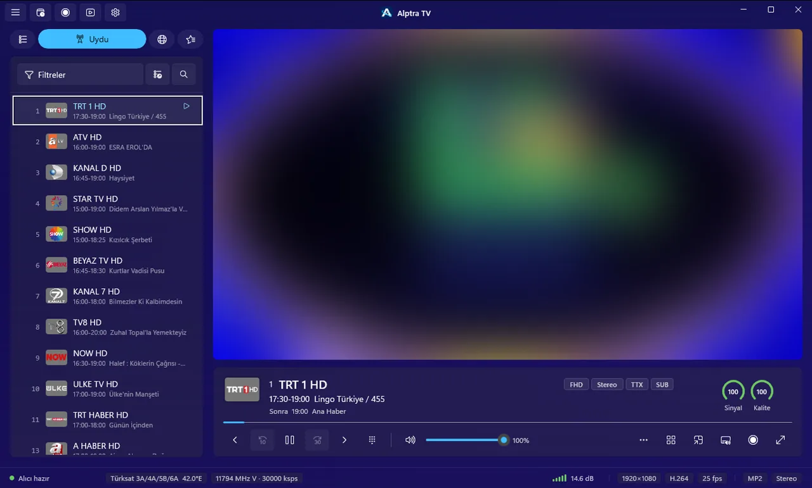
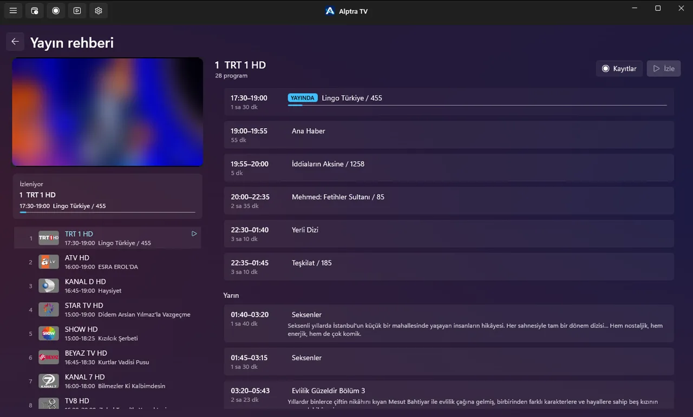
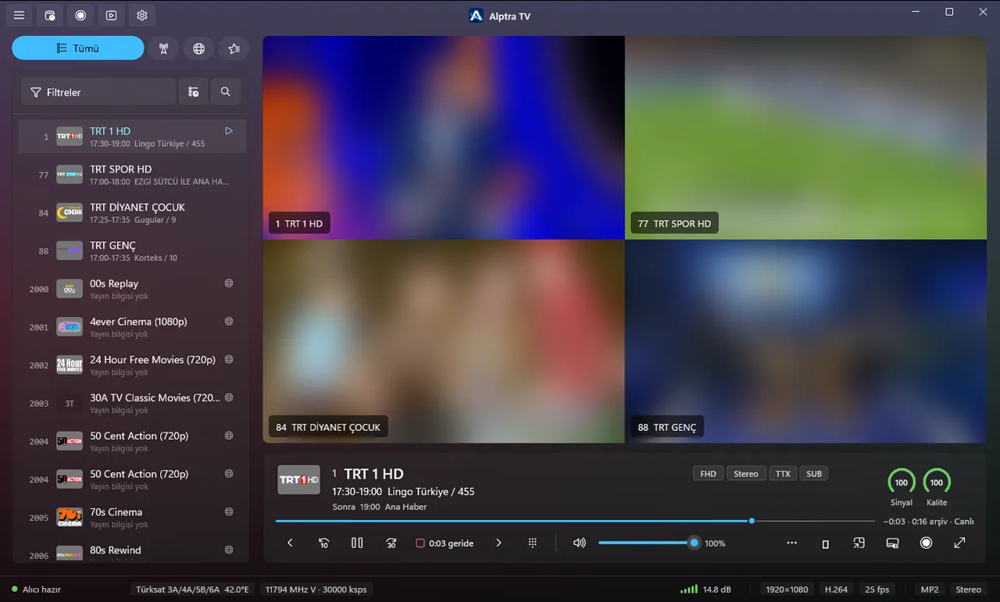

<p align="center">
  
</p>

<h1 align="center">Windows için Alptra TV</h1>

<p align="center">
  Windows 10 ve 11 için uydu ve IPTV oynatıcısı.<br>
  <a href="https://alptra.xacnio.dev">Web sitesi</a> ·
  <a href="https://github.com/xacnio/alptra-tv-windows/releases/latest">Son sürüm</a> ·
  <a href="https://apps.microsoft.com/detail/9NX6G6PXDHKC">Microsoft Store</a> ·
  <a href="README.md">English</a>
</p>

<p align="center">
  
  
</p>

Ücretsiz, hesap gerekmez. Bu depoda Windows indirmeleri var; uygulama Microsoft Store'da da
bulunuyor.

<p align="center">
  <a href="https://github.com/xacnio/alptra-tv-windows/releases/latest"></a>
  <a href="https://apps.microsoft.com/detail/9NX6G6PXDHKC"></a>
</p>

## İndir

Dosyaları [son sürümden](https://github.com/xacnio/alptra-tv-windows/releases/latest) indir:

| Dosya | Kimin için |
|---|---|
| `AlptraTV_<sürüm>_x64_setup.exe` | Çoğu bilgisayar (Intel, AMD). **Emin değilsen bunu al.** |
| `AlptraTV_<sürüm>_arm64_setup.exe` | ARM işlemcili Windows (Snapdragon) |
| `AlptraTV_<sürüm>_x64.zip` | Taşınabilir sürüm, x64 |
| `AlptraTV_<sürüm>_arm64.zip` | Taşınabilir sürüm, ARM64 |

Windows 10 (sürüm 2004) veya üstü gerekir. Kurulum yönetici izni istemez. Taşınabilir sürüm için
zip'i istediğin yere çıkar ve `Alptra.Tv.App.exe`'yi çalıştır. Ayarların ve kanal listelerin ayrı
tutulur; güncellesen de kaldırsan da kaybolmaz.

### "Windows bilgisayarınızı korudu" uyarısı

Dosyalar kod imzalı olmadığı için SmartScreen ilk açılışı durdurabilir. **Ek bilgi**'ye, sonra
**Yine de çalıştır**'a tıkla. Bir dosyayı kontrol etmek istersen her sürümde SHA-256 değerleri ve
VirusTotal taramaları var:

```powershell
Get-FileHash .\AlptraTV_<sürüm>_x64_setup.exe
```

## Güncelleme

Kurulu sürüm güncellemeleri kendisi denetler (Ayarlar → Güncellemeler) ve tek tıkla kurar; istersen
otomatik de yapar. Taşınabilir sürüm yeni sürüm çıkınca haber verir; yeni zip'i eski klasörün
üstüne çıkarman yeterli. Store sürümünü Store günceller.

## Özellikler

- USB alıcıdan uydu yayını: DVB-S/S2, kanal tarama, kör tarama
- SAT>IP alıcılar ve USB alıcını evdeki diğer cihazlarla paylaşma
- M3U ve Xtream Codes listeleri, uydu kanallarınla tek listede
- Yayın akışı (yayından ve XMLTV'den) ve teletext
- Aynı anda birden çok kanal
- Kayıt, zamanlanmış kayıt, canlı yayını durdurma ve geri sarma
- Film ve dizi kitaplığı, radyo, kanal yöneticisi
- YouTube, Twitch ve Kick kanalları

<p align="center">
  
</p>

## İletişim

Bir hata mı buldun, bir fikrin mi var? [Issue aç](https://github.com/xacnio/alptra-tv-windows/issues/new/choose)
ya da [alptra@xacnio.dev](mailto:alptra@xacnio.dev) adresine yaz.
Projeye destek: [Buy Me a Coffee](https://buymeacoffee.com/xacnio)

© 2026 Alperen Çetin
